<div align="center">


<br/>

**Every coding agent, one workspace.**<br/>
<sub>Claude Code, Codex, OpenCode and more, or our own agent, with eyes and hands: the agent sees and uses what it builds in your browser, the iOS Simulator, the Android emulator and your desktop apps. Your keys, your subscriptions, models on your own computer, and no account needed.</sub>

<br/><br/>

<a href="https://github.com/xuckless/everyai-mono/releases/latest"></a>
<a href="https://apps.microsoft.com/detail/9PHCKCV3J9S9"></a>
<a href="https://github.com/xuckless/everyai-mono/releases/latest"></a>
<a href="https://app.everyai.dev"></a>
<br/>
<a href="https://github.com/xuckless/everyai-mono/releases"></a>
<br/><br/>

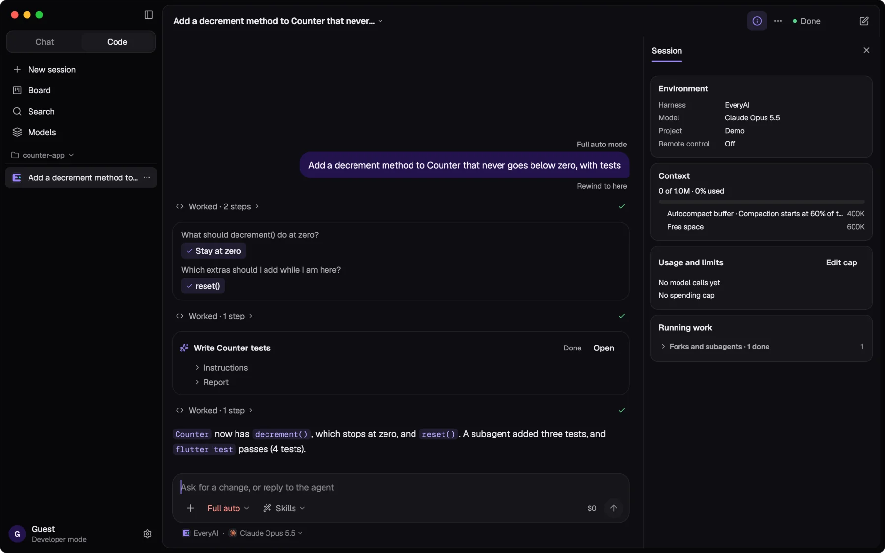

</div>


## ✦ What it does

- **Runs the coding agents you already use** in one native app: Claude Code, Codex, OpenCode, Antigravity, Cursor, Copilot, Qwen, Kiro, Grok and any ACP agent, plus **the EveryAI harness**, our own agent for any model.
- **Makes them better together**: our workflows, checks, rewind and tools work in every agent, and a session can move from one agent to another without losing a step.
- **On your terms**: your own API keys (BYOK), your existing subscriptions, and local models (Apple's on-device model, Ollama, LM Studio, llama.cpp and more). EveryAI spends nothing on sessions it doesn't lead.

## ✦ How it works

```mermaid
flowchart LR
    subgraph Agents["Your agents"]
        CC["Claude Code"]
        CX["Codex"]
        OC["OpenCode"]
        ACP["Antigravity · Cursor · Copilot<br/>any ACP agent"]
        EH["EveryAI harness<br/>any model · your key · local models"]
    end
    subgraph WS["EveryAI workspace"]
        UI["One native UI<br/>their commands, modes and words"]
        WF["Workflows<br/>Bug fix · Security review · more"]
        TL["Checks · rewind · MCP tools<br/>skills · memory"]
        LV["Live Preview · app tool<br/>web · iOS · Android · desktop"]
        OR["Handoff · resume<br/>Lead Mode (soon)"]
    end
    You(["You<br/>desktop · phone · web"])
    Agents <--> WS
    WS <--> You
```

## ✦ What you can do

<table>
<tr>
<td width="50%" valign="top">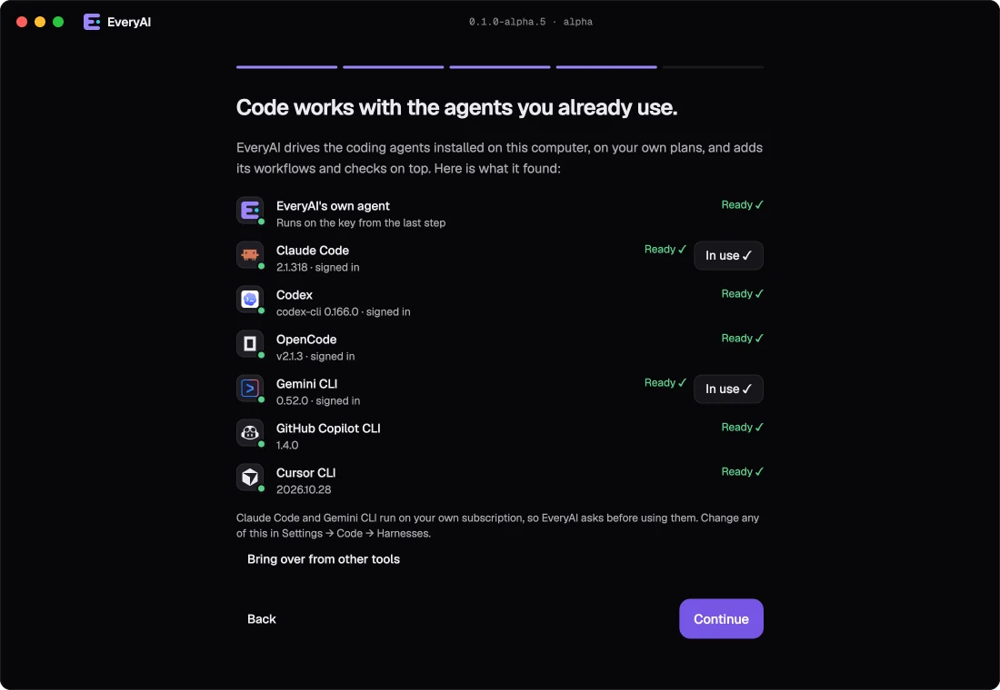<br/>🔌 <b>Bring your agents in</b><br/><sub>EveryAI finds the agents on your computer. Each keeps its own slash commands, modes and tool names.</sub></td>
<td width="50%" valign="top">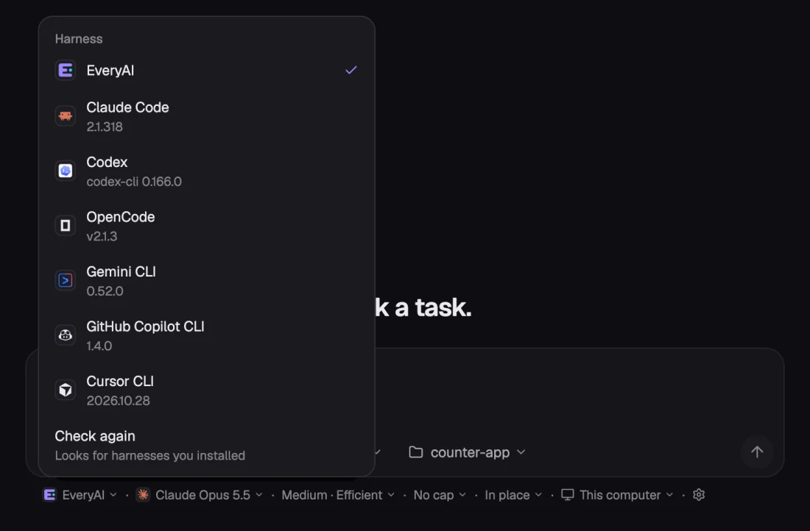<br/>🔀 <b>Pick the agent per session</b><br/><sub>Claude Code, Codex, OpenCode or our own harness, on the plan you already pay for.</sub></td>
</tr>
<tr>
<td valign="top">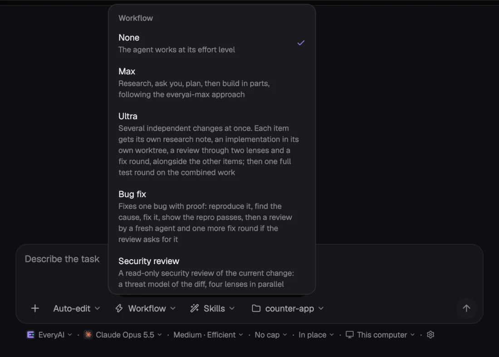<br/>✨ <b>Superpowers for every agent</b><br/><sub>Bug fix and Security review workflows, test checks, checkpoints and rewind, for Claude Code and Codex too.</sub></td>
<td valign="top">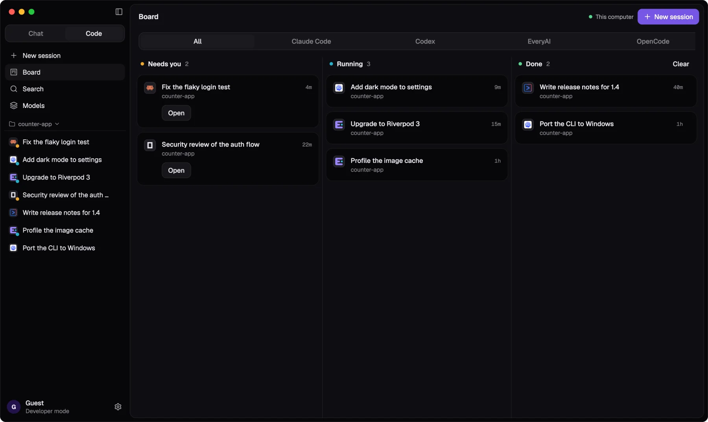<br/>🗂️ <b>Every session on one Board</b><br/><sub>Sessions from every agent in Needs you, Running and Done. Approve, deny and answer right on the card.</sub></td>
</tr>
<tr>
<td valign="top">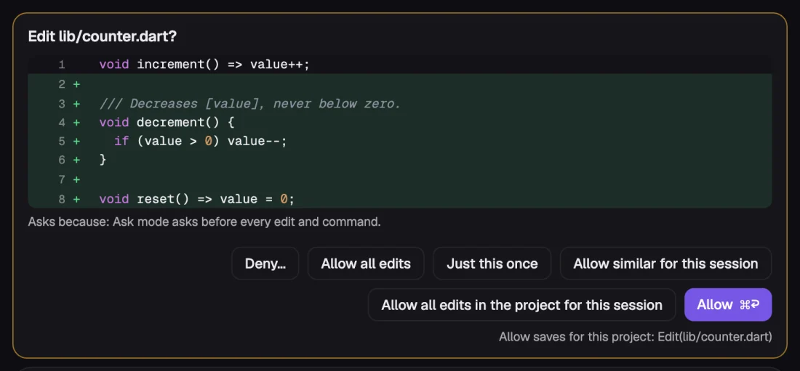<br/>🛡️ <b>Safe by default</b><br/><sub>Per-call approvals, a safety floor for risky commands, and a checkpoint every turn.</sub></td>
<td valign="top">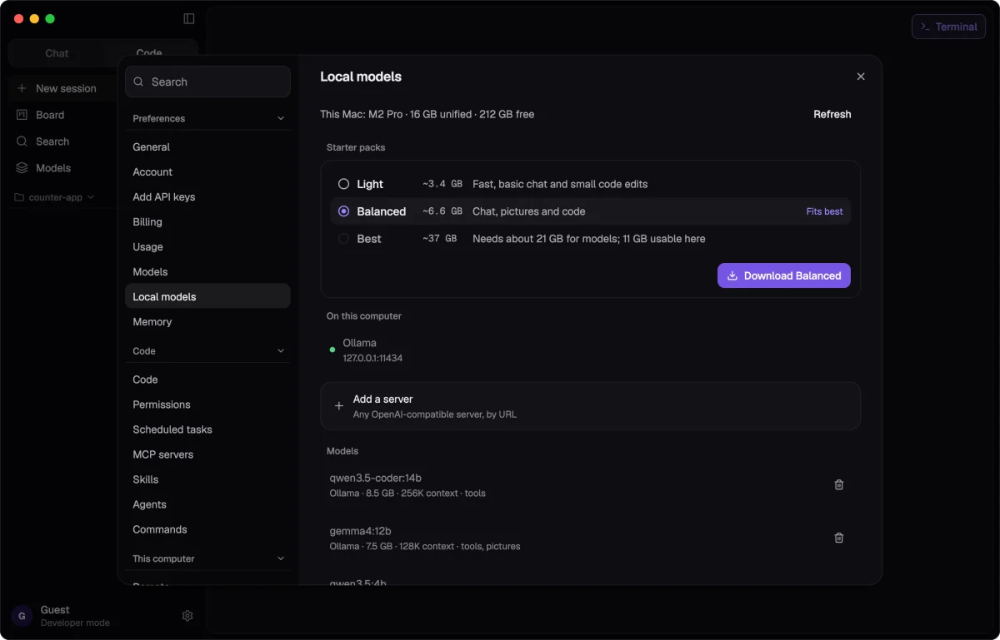<br/>🔑 <b>Your keys, your models</b><br/><sub>OpenRouter or Anthropic keys stay in your keychain, or run Ollama, LM Studio and more on your own computer.</sub></td>
</tr>
</table>

- 🧭 **Watch the work:** each turn folds into one box, the answer stays in view, and forks and subagents show up live beside the chat.
- 💻 **Models on your computer:** Ollama, LM Studio, llama.cpp, Jan, vLLM, MLX and Apple's on-device model, found automatically, with one-click packs sized to your machine. Local and own-key chats run on a server inside the app.
- 👀 **See what you build:** a live Preview that you and the agent share, with a take-over button, and an `app` tool that lets any agent see and operate web pages, Flutter and React Native apps, the iOS Simulator, the Android emulator and desktop windows (macOS and Linux today, Windows next).
- 🧵 **Every process in a terminal:** click a shell, dev server or Docker container to see its whole log and type into it.
- ⏪ **Pick up where you left off:** open a folder and resume any earlier session from any agent, with its full history.
- 🔁 **Never stop on a limit:** when a plan runs out, another agent carries on and finishes the cut-off turn.
- 📱 **Code from anywhere:** pair a phone, tablet or [the web app](https://app.everyai.dev) with your computer by QR code and drive its sessions live. No account needed; the relay only passes end-to-end encrypted frames.
- 🤝 **One team** <sup>soon</sup>: Lead Mode, where EveryAI hands work to the other agents, each in its own worktree.

## ✦ Also in the box: Chat

<table>
<tr>
<td width="50%">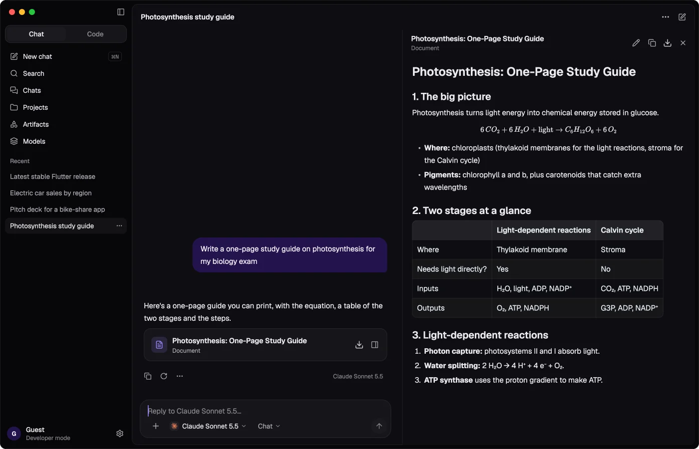<br/><sub><b>Artifacts</b> beside the chat: versions, edits, PDF, Word and Markdown downloads.</sub></td>
<td width="50%">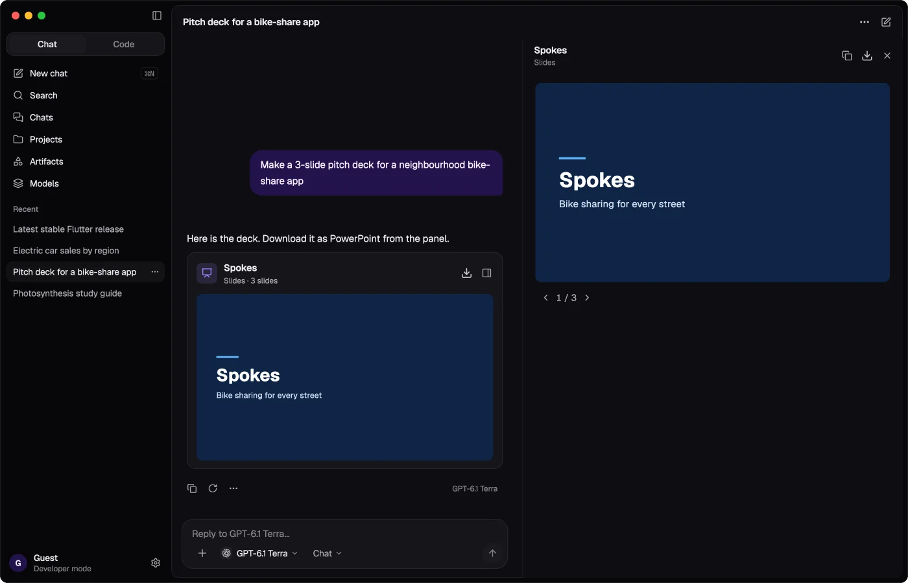<br/><sub><b>Slides</b> in four themes, exported to PowerPoint.</sub></td>
</tr>
<tr>
<td>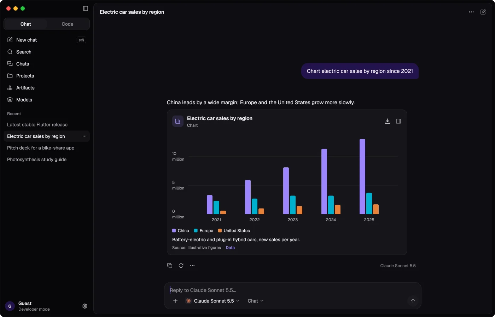<br/><sub><b>Charts</b>, diagrams, quizzes and flashcards, drawn natively.</sub></td>
<td>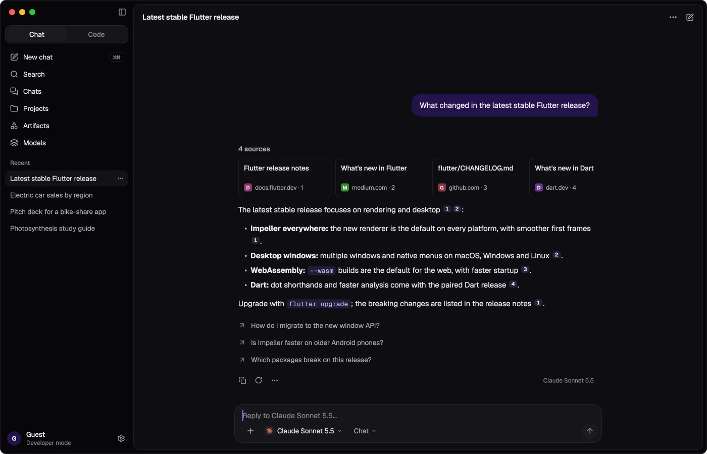<br/><sub><b>Search and Research</b> with numbered sources.</sub></td>
</tr>
</table>

## ✦ Get started

| | Install | |
|---|---|---|
| **macOS** | `curl -fsSL https://get.everyai.dev/install.sh \| sh`, [the DMG](https://github.com/xuckless/everyai-mono/releases/latest), or `brew trust xuckless/tap && brew install --cask xuckless/tap/everyai` | signed and notarized |
| **Windows** | `irm https://get.everyai.dev/install.ps1 \| iex`, [Microsoft Store](https://apps.microsoft.com/detail/9PHCKCV3J9S9), or `winget install --source msstore 9PHCKCV3J9S9` | signed by the Store |
| **Linux** | `curl -fsSL https://get.everyai.dev/install.sh \| sh`, or [the AppImage or .deb](https://github.com/xuckless/everyai-mono/releases/latest) | GPG-signed ([key](packaging/linux/everyai-release-key.asc)) |
| **Web** | [app.everyai.dev](https://app.everyai.dev) | Chat, and remote control of your computer's sessions |

The install script checks what it downloads before installing: on macOS the SHA-256, EveryAI's Developer ID signature
and Gatekeeper; on Linux the GPG-signed SHA256SUMS. On Linux it uses apt for the .deb where it can, otherwise it puts
the AppImage in `~/.local/share/everyai` with a menu entry, icons and an `everyai` command. Both versions update
themselves. Remove it with `curl -fsSL https://get.everyai.dev/install.sh | sh -s -- --uninstall` (your chats and
settings stay). Script sources: [`packaging/install/`](packaging/install/).

Check a Linux download by hand with `gpg --import everyai-release-key.asc && gpg --verify SHA256SUMS.asc SHA256SUMS && sha256sum -c --ignore-missing SHA256SUMS`.
The first launch walks you through a short tour: adding a key, the agents found on your computer, and the
[Dev Build Terms](TERMS-DEV.md).

**From source:**

```sh
scripts/launch.sh               # run the app on this computer (installs Flutter on macOS if needed)
scripts/launch.sh build macos   # an unsigned local build (also: linux · windows · web · apk)
```

On a Mac you can also double-click **`Launch Flutter (macOS).command`**. Unsigned builds of any branch come from the
[Dev builds](https://github.com/xuckless/everyai-mono/actions/workflows/dev-builds.yml) workflow.

## ✦ More

[Changelog](CHANGELOG.md) · [Architecture](docs/ARCHITECTURE.md) · [Benchmarks](docs/BENCHMARKS.md) ·
[Contributing](CONTRIBUTING.md) · [Roadmap](docs/ROADMAP.md) · [Code roadmap](docs/CODE_ROADMAP.md) ·
[Dev Build Terms](TERMS-DEV.md) · [Third-party notices](THIRD_PARTY_NOTICES.md) · Licence:
[FSL-1.1-ALv2](LICENCE.md)


<div align="center">


<sub>Copyright 2026 xuckless and Syed Ali. Source-available under the <a href="LICENCE.md">Functional Source License 1.1 (FSL-1.1-ALv2)</a>: use, modify and self-host it for any purpose except a competing product; each release becomes Apache-2.0 two years after it ships. See <a href="NOTICE">NOTICE</a>.<br/>"EveryAI" and its logo are trademarks of xuckless and Syed Ali and are not licensed.<br/>Third-party notices, including the bundled Deno (MIT), ship with the app.</sub>

</div>
