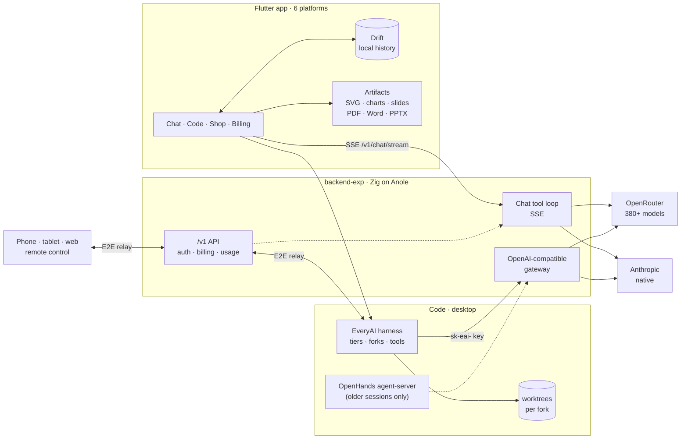

<div align="center">


<br/>

<a href="#-platforms"></a>
<a href="#-platforms"></a>
<a href="#-platforms"></a>
<a href="#-platforms"></a>
<a href="#-platforms"></a>
<a href="#-platforms"></a>

<br/>


<br/><br/>

**Chat with any model. Build with a real coding agent. Keep what it makes.**<br/>
<sub>Native UI on six platforms · one wallet (or your own keys) for every model · a coding agent that runs any model · artifacts you can open, edit and download.</sub>

<br/>


</div>


## ✦ Highlights

<table>
<tr>
<td width="33%" valign="top">

### 💬 Chat modes
Any of 380+ models in one composer, with modes **Chat · Search · Research · Learn · Summarise**. Search lets the model search and read pages itself (cached, every source numbered once). **Research** is our own harness: parallel researchers on a roster of models, Quick/Standard/Deep. The model can suggest a better mode, and **follow-ups** stay in your language.

</td>
<td width="33%" valign="top">

### 🧩 Rich answers
Models answer with **artifacts** (docs, code, sandboxed HTML), **SVG** figures with a design brief and **Polish**, **Mermaid** and **Excalidraw** diagrams, **charts** (also inside documents), generated **images**, **quizzes**, **flashcards**, **slide decks** and **question cards**.

</td>
<td width="33%" valign="top">

### 🛠️ Code workspace
The **EveryAI harness**: our own agent loop, built to run *any* model, with per-family tools (`apply_patch` for GPT). Tiers **Efficient → Thorough → Max → Ultra**: Max runs research → questions → plan → build → verify, with forks in their own worktrees that an orchestrator monitors and merges. **Bug fix** mode, per-call approvals with a safety floor, retries, gentle compaction, a headless **browser** and window **screenshots** for checking its own work.

</td>
</tr>
<tr>
<td valign="top">

### 📥 Download anything
One menu per artifact: **Markdown** (SVG inline), **Markdown + figures (.zip)**, **PDF**, **Word**, **PowerPoint**, **SVG/PNG**. Figures are drawn exactly as the app shows them.

</td>
<td valign="top">

### ✏️ Edits, not duplicates
`edit_artifact` revises a document in place with find-and-replace edits. The backend checks every edit and tells the model which ones missed.

</td>
<td valign="top">

### 💸 Honest billing, or your own keys
Free, Pro and Max plans plus prepaid top-ups at upstream cost × 1.15; free models stay free. **BYOK:** bring an OpenRouter key (every model) or an Anthropic key (Claude), kept in the keychain, and pick the biller per model in the shop. A live **token, cache and cost meter** sits in every composer, plus a Usage screen.

</td>
</tr>
<tr>
<td valign="top">

### ⚡ Prompt caching
A constant system prompt and tool list with cache breakpoints, in chat and the gateway. In the [BrowserOS benchmark](docs/benchmarks/browseros/README.md) every EveryAI run hit **91–96% cached** prompt tokens; the OpenHands baseline hit 12.6% and cost 2–5× more for the same model and task.

</td>
<td valign="top">

### 📎 Attachments
Images, PDFs, audio and text files, greyed out per model when it can't read them. Drag and drop anywhere. Code sessions get them inside the worktree.

</td>
<td valign="top">

### 📱 Remote control and native UI
Phones, tablets and the web **pair with your computer** (QR, end-to-end encrypted relay) and drive its Code sessions live. Cupertino, Material, Fluent and macOS designs from one codebase, one type scale, one searchable Settings modal.

</td>
</tr>
<tr>
<td valign="top">

### ⌨️ Slash commands and skills
One `/` menu in both composers: built-ins (`/plan`, `/compact`, `/rewind`, `/review`, `/goal`, `/commit`, `/pr`, `/teach`…), Markdown custom commands, and **Agent Skills** with import and a trust gate.

</td>
<td valign="top">

### 🔌 MCP and agents
Code sessions use **MCP servers** from Settings (with consent for local commands) and an **agent library** of roles that forks take, each on a model you pick.

</td>
<td valign="top">

### 🧠 Memory, on device
Local memory notes and search over earlier chats, both client-side tools. Chat history never leaves the device.

</td>
</tr>
</table>


## ✦ Tour

<table>
<tr>
<td width="50%"><br/><sub><b>Artifacts</b> open beside the chat, with versions, copy and download.</sub></td>
<td width="50%"><br/><sub><b>Slides</b> render in four themes and export to PowerPoint.</sub></td>
</tr>
<tr>
<td><br/><sub><b>Charts</b>: line, area, bar, scatter and pie, drawn natively.</sub></td>
<td><br/><sub><b>Search</b> with source chips and inline citations.</sub></td>
</tr>
<tr>
<td><br/><sub><b>Question cards</b>: the agent asks, you pick, it builds.</sub></td>
<td><br/><sub><b>Code sessions</b> show steps, diffs, mode, model · effort and cost.</sub></td>
</tr>
<tr>
<td><br/><sub><b>Model shop</b>: the whole OpenRouter catalog, with filters and vendors.</sub></td>
<td><br/><sub><b>Plan & usage</b>: quota, wallet, cache savings and recent calls.</sub></td>
</tr>
</table>

<details>
<summary><b>One codebase, four design languages</b> (click to expand)</summary>
<br/>
<table>
<tr>
<td width="50%"><br/><sub>Cupertino</sub></td>
<td width="50%"><br/><sub>Material</sub></td>
</tr>
<tr>
<td><br/><sub>Fluent</sub></td>
<td><br/><sub>Adwaita-style</sub></td>
</tr>
</table>
</details>


## ✦ How it fits together




## ✦ Repository

| Path | What | Stack |
|---|---|---|
| [`frontend/`](frontend) | The app: chat, Code workspace, artifacts, model shop, billing |    |
| [`frontend/packages/everyai_markdown`](frontend/packages/everyai_markdown) | Streaming Markdown renderer: math, highlighting, citations |  |
| [`backend-exp/`](backend-exp) | The `/v1` API: auth, chat tool loop, gateway, images, billing |   |
| [`backend/`](backend) | Legacy FastAPI service, frozen and being replaced |  |
| [`docs/`](docs) | [`ROADMAP.md`](docs/ROADMAP.md), [`CODE_ROADMAP.md`](docs/CODE_ROADMAP.md), [benchmarks](docs/benchmarks/browseros/README.md) |  |
| [`scripts/`](scripts) | `dev.sh`, the one-command dev runner |  |

## ✦ Quick start

> [!NOTE]
> You need **Flutter 3.47** and **Zig 0.17**. [Anole](https://github.com/xuckless/anole) 0.4.1 is fetched by `zig build` from its release tag. Code needs Google Chrome (or Chromium/Edge/Brave) for the agent's browser tool.

```sh
cp .env.example .env            # add OPENROUTER_API_KEY (and ANTHROPIC_API_KEY if you have one)
cp frontend/config/example.json frontend/config/dev.json

scripts/dev.sh macos            # or: web · ios-sim · ios · <device id>
```

`dev.sh` starts `backend-exp` on `:8080` (or reuses a running one), fetches the OpenHands agent-server (only older Code sessions use it; new ones run on the EveryAI harness), writes the right `API_BASE_URL` for the target, and runs the app.

<details>
<summary><b>Run the pieces by hand</b></summary>

```sh
# Backend (http://localhost:8080, API docs at /docs)
cd backend-exp && zig build run
zig build test

# App
cd frontend && flutter pub get
flutter run -d macos --dart-define-from-file=config/dev.json
flutter test
```

</details>

<details>
<summary><b>Configuration</b></summary>

- **Secrets:** one `.env` at the repo root (template `.env.example`). Never commit it.
- **`DEV_AUTH=true`:** anonymous requests act as a dev user on the Pro plan with $20 of credit.
- **Claude routing:** Settings → Developer chooses whether `anthropic/*` models go through OpenRouter or the native Anthropic API.
- **Your own keys:** Settings → API keys takes an OpenRouter or Anthropic key (stored in the keychain, sent per request, never billed). Ultra on your own key has a spend cap you set.
- **Firebase / Google Sign-In files** (`GoogleService-Info.plist`, `google-services.json`) are gitignored. Put them in the platform folders locally.

</details>

## ✦ Platforms

| | macOS | iOS | Android | Windows | Linux | Web |
|---|:-:|:-:|:-:|:-:|:-:|:-:|
| **Chat, artifacts, shop, billing** | ✅ | ✅ | ✅ | ✅ | ✅ | ✅ |
| **Code workspace** | ✅ | remote control | remote control | desktop build | desktop build | remote control |
| **Inline web artifacts (HTML, Mermaid)** | ✅ | ✅ | ✅ | ✅ | open in browser | ✅ |
| **Verified so far** | ✅ daily driver | simulator | — | untested (needs CI) | untested (needs CI) | ✅ |

## ✦ Roadmap

<table>
<tr>
<td>🛡️ <b>Sandboxed shell</b><br/><sub>Seatbelt / bubblewrap · network policy per mode</sub></td>
<td>🤖 <b>Headless & hooks</b><br/><sub><code>everyai exec</code> for CI · Pre/PostToolUse hooks</sub></td>
<td>🔌 <b>Connectors</b><br/><sub>backend MCP client · OAuth vault · GitHub · Google · Notion</sub></td>
</tr>
<tr>
<td>🖋️ <b>Vector art</b><br/><sub>resvg render check · SVG eval run live</sub></td>
<td>🧪 <b>Evidence</b><br/><sub>more models through the benchmark · Code eval suite</sub></td>
<td>🚀 <b>Release</b><br/><sub>signed macOS build · Windows/Linux CI · App Store variant</sub></td>
</tr>
</table>

The full plan is in [`docs/ROADMAP.md`](docs/ROADMAP.md) and [`docs/CODE_ROADMAP.md`](docs/CODE_ROADMAP.md).


## ✦ Harness benchmark

One prompt (a browser OS in a single file: 5+ apps, two working 3D games, procedural wallpapers, a Messages app, a special feature) run on several models and companies. Costs are what EveryAI charged, including side calls. Full stat sheets: [`docs/benchmarks/browseros/`](docs/benchmarks/browseros/README.md).

| Run | Model | Effort | Tier | Harness | Charged | Cache hit | Wall | Calls | Tools /10 | Result (review) /10 | Result (owner) /10 |
|---|---|---|---|---|---|---|---|---|---|---|---|
| [sonnet-browseros-efficient](docs/benchmarks/browseros/sonnet-browseros-efficient/results.md) | `anthropic/claude-sonnet-5.5` (Anthropic) | medium | Efficient | EveryAI | $1.550 | 91.5% | 10.4 min | 15 | 7 | 7.5 | **7** |
| [sonnet-browseros-thorough](docs/benchmarks/browseros/sonnet-browseros-thorough/results.md) | `anthropic/claude-sonnet-5.5` | medium | Labelled **Thorough** | EveryAI | $3.399 | 94.8% | 23.8 min | 28 | 8 | 8.5 | **9** |
| [terra-browseros-max](docs/benchmarks/browseros/terra-browseros-max/results.md) | `openai/gpt-6.1-terra` | medium | Max | EveryAI | $0.952 | 91.3% | 4 h 09 min | 126 | 5 | 7.5 | **6** |
| [kimi-browseros-max](docs/benchmarks/browseros/kimi-browseros-max/results.md) | `moonshotai/kimi-k2.6` | medium | Max | EveryAI | $1.438 | 92.9% | 14.0 min | 120 | 5 | 6.5 | **5** |
| [deepseek-flash-browseros-medium--max](docs/benchmarks/browseros/deepseek-flash-browseros-medium--max/results.md) | `~deepseek/deepseek-flash-latest` | medium | Max | EveryAI | $1.480 | 95.7% | 23.2 min | 561 | 9 | 8.5 | **9** |
| [open-hands-impl-sonnet-medium](docs/benchmarks/browseros/open-hands-impl-sonnet-medium/results.md) | `anthropic/claude-sonnet-5.5` | medium | Efficient | OpenHands agent-server | $7.778 | 12.6% | 29.2 min | 34 | 6 | 7 | **9** |


## ✦ What's new (2026-10-30 → 2026-10-31)

175 commits since the last README, by area. The highlights:
- **The EveryAI harness** replaces OpenHands for new Code sessions: any model, per-family tools, tiers up to Max/Ultra with enforced phases, forks in worktrees run by an orchestrator, Bug fix mode, retries, per-call approvals, gentler compaction, write-in-parts, and a browser and screenshots for checking its own work.
- **Chat modes** Learn, Summarise, Search and Research (our own multi-model research harness), charts inside documents, images, Excalidraw, Polish for figures, memory and chat search.
- **Remote control** from phones, tablets and the web; **BYOK** for OpenRouter and Anthropic; a searchable **Settings** modal; **MCP**, **skills**, **agents** and **slash commands**.
- **Backend** hardening from the Anole docs audit, and the **FSL-1.1-ALv2** licence.

<details>
<summary><b>🛠️ EveryAI harness: the agent loop</b> (32)</summary>

- `870cf22` Add the EveryAI harness: an agent loop in the app beside OpenHands
- `9a7555d` Add a live check that drives the EveryAI harness on a real model
- `4df6519` Fork subagents and compact in place on the EveryAI harness
- `9845133` Judge /goal with the session's own model on the EveryAI harness
- `03aefaf` Export a Code session as Markdown and add the browser OS harness check
- `a13d088` Add a Tasks pane listing a session's subagents, forks and background commands
- `bf357e3` Serve the EveryAI harness to paired devices over the agent-server protocol
- `9fde0b9` Compact EveryAI sessions in place with /compact
- `891fe3e` Let a library agent run a Code session as its main agent
- `cde9bfc` Run EveryAI subagents in the background on request
- `c0d0e20` Record cached prompt tokens and add a live fork cache check
- `135dd4a` Let EveryAI agents look at images they read
- `bced7af` Connect EveryAI sessions to the project's MCP servers
- `74afddd` Tell EveryAI agents they can look at what they build, and check it live
- `79c25a1` Add an efficiency-to-quality work style for Code sessions
- `3216a87` Give each EveryAI fork its own worktree and merge it back when done
- `709f635` Add a live check of a fork editing its worktree and merging back
- `90ed7ff` Keep an EveryAI reply's text between its tool calls, and stream tool progress
- `4841275` Ask EveryAI agents to work in visible steps and to wait for dependent results
- `8413e77` Wake an EveryAI agent that sleeps to wait for its forks; check UIs through real clicks
- `c4f5b9f` Stub out harness switching: new sessions run on EveryAI, and OpenHands starts only when an old session needs it
- `a467ca6` Keep a session off the files its subagents are changing
- `cc6467f` Run each web search once per session
- `6a856c0` Code: retry model calls on transient errors
- `0ef3ad0` Code: answer each pending call on its own; run more reads in parallel
- `e6a18f3` Code: clear old tool output before summarizing; carry the working state over a compaction
- `0fc7f33` Code: tools and rules per model family; apply_patch for GPT models
- `39b53c2` Code: fixes from the Gemini Flash and Kimi K2.6 Max runs
- `4792bdf` Code: build big files in parts with write mode append
- `bf5d5ce` Code: a browser and window screenshots for the agent, and a debugging routine
- `6d553c4` Code: Option-Enter sends now again; shortcut hints drawn as text
- `644f490` Tests: the approval card's Allow all label comes from Host.enterKeys

</details>
<details>
<summary><b>🧭 Tiers, forks and orchestration (Max, Ultra, Bug fix)</b> (15)</summary>

- `2c3010d` Let the Code agent hand work to subagents that run as their own conversations
- `08e9b59` Add an agent library that subagents can be started with
- `51ec34c` Add the Ultra engine: a planned multi-agent run with caps and a journal
- `76f268f` Add the Ultra toggle, caps and a live progress tree to Code sessions
- `5d09d58` Hold Code budgets in the background and stop Ultra steps' leftover processes
- `35c64bf` Count all of an Ultra run's spend against its cap
- `1901c77` Make library agents roles that forks take, each on a model the user picks
- `bcaf9e0` Run Max sessions as a research → questions → plan → build → verify flow the harness enforces
- `62a3bec` Replace Ultra with a tier: Max's flow, with research run as a workflow the session sizes
- `d9b225d` Let the orchestrator pick each child's model from the user's models
- `715eb52` Add Bug fix mode: reproduce, triage, research when hard, plan, fix, verify, with the harness checking each step
- `903c745` Max in Full auto: approve the plan inside the held call, so the plan gate opens
- `ded7c3a` Show Max/Ultra progress only in the phase strip; result files on devices
- `302e85c` Code: the orchestrator runs its forks: their questions, check-ins, stops and integration
- `7604ce6` Put a tier bar in the Code agent menu and slim the session top bar

</details>
<details>
<summary><b>🔒 Code safety and permissions</b> (11)</summary>

- `7d2c7f9` Decide every Code action in the app, with a safety floor that holds even in Full auto
- `0370141` Keep web_fetch away from local and private networks
- `e66b8e9` Make Stop end every process a Code session left running
- `373dc3d` Pause and ask when the agent repeats the same step, and keep huge tool output out of the transcript
- `046a6cb` Close gaps in the command checks that let writes and wipes through
- `4794609` Keep a cloned repository from approving its own commands or reading files outside it
- `f0642ed` Make Stop leave the user's own tmux panes alone
- `345a9e9` Ask before editing outside the project in Full auto; keep agent scratch out of git
- `11cb3f6` Sandbox research jobs and send every Code web fetch through the safe fetcher
- `d6f7637` Ask before running commands that came with a project, remember the window size, and add a Projects page
- `5062ccc` Show the whole text of a project command, agent or skill before trusting it

</details>
<details>
<summary><b>📋 Code workspace UI</b> (23)</summary>

- `4a7e373` Keep Changes and the usage meter current while the agent works
- `4231e62` Answer question cards and plans inside the tool call so the agent keeps its turn
- `5504d34` Load the project's AGENTS.md files into Code sessions ourselves
- `797ab6b` Compact a Code session into a summary and a fresh conversation
- `d2081ad` Stop telling the Code agent that long tool output is cut for it
- `f43f7c1` Switch the Code agent's model and effort from one menu, live
- `3b63cf2` Keep Code sessions going through key refusals and sidecar crashes, and bundle the agent server
- `ac32608` Add a Code top bar with layered settings and system prompts
- `a16e08c` Add Terminal, Processes and Preview panes beside Code sessions
- `86be6f3` Show the files an agent finished with, and notify when a session needs you
- `99b1168` Rewind a Code session's conversation along with its files
- `3340346` Start Code sessions in repositories that have no commits yet
- `f6b3839` Let the Code session title flex, key transcript rows and link edits to Changes
- `3318db3` Work in place by default, with Changes against the session's starting snapshot, and give Settings one shell
- `b8ce3c6` Let Code rows shrink instead of overflowing on narrow windows
- `d1d926a` Finish worktree sessions from Changes: push, open, and remove after merge
- `5f107fc` Set a spending cap when starting a Code session
- `31595e2` Show the EveryAI mark for the agent's thoughts instead of a generic sparkle
- `1a62665` Remove projects from the Code project picker
- `47ca446` Don't treat a home-folder dotfiles repo as a project's repository
- `b122e6e` Bring the session's controls to the New session page; scroll the settings popover
- `3b052b1` Show Changes for in-place sessions in a repository with no commit yet
- `654a628` Show the agent's task list only above the composer

</details>
<details>
<summary><b>🔌 MCP, skills, agents and slash commands</b> (14)</summary>

- `7ccf4db` Let Code sessions use MCP servers set up in Settings
- `4e511e7` Note why mcp_config is a flat map of servers
- `f419963` Open a command menu when a message starts with a slash
- `3c65685` Run saved prompts as custom slash commands from Markdown files
- `9ae7f25` Let a chat request force the first tool call, and draft skills from a conversation
- `1b50253` Add the chat slash commands: model, effort, new, retry, make commands, export and learn
- `01d72d0` Let Code sessions use Agent Skills, with import and a trust gate
- `ba31c1b` Add the Code session commands: plan, build, model, effort, clear, compact, rewind, stop, cost and btw
- `4d56d52` Let Chat use the user's skills, loaded on demand
- `0973af3` Ship four built-in skills that steer slides, documents, diagrams and vector art
- `85eb184` Add the Code commands review, goal, commit, pr, learn and morning
- `c566f64` Keep project commands in their project and rank exact command names first
- `53effff` Harden skill imports, project skill trust and bundled skill updates
- `5d81fa6` Resolve /learn ./ and ../ paths against the session's folder

</details>
<details>
<summary><b>💬 Chat: tools, modes, search and research</b> (16)</summary>

- `5ff6942` Let chat turns wait for tools the app runs itself
- `b765d47` Recover from replies cut off by the output limit instead of stalling
- `c921dc2` Count DeepSeek cache hits as cached tokens
- `894ec15` Let chat answers search the web, number every source once, and read long pages in windows
- `519a93f` Let chat answers ask the user multiple-choice questions in a card
- `8cacb80` Keep reasoning across tool steps and let chats pick a thinking effort
- `3a08c8c` Keep local memory notes and let chats search earlier chats on the device
- `f647a0a` Route side jobs to cheap models and keep follow-ups in the user's language
- `c247d23` Wire memory and chat search into the chat turn
- `d3ffbc3` Keep memory out of system authority and in step with what the user keeps
- `735ef14` Add a thinking-effort menu to the chat composer, kept per conversation
- `3a5cbac` Ask Anthropic models for a forced tool in words when thinking is on
- `d35d61b` Question cards: mark the agent's recommended option
- `45c630d` Chat modes: Learn and Summarise, mode blocks, and suggested switches
- `07c5c6f` Search mode: the model searches and reads itself; searches are cached
- `4709a36` Research mode: our own harness with parallel researchers on a roster of models

</details>
<details>
<summary><b>🎨 Artifacts, figures and images</b> (17)</summary>

- `2d0bb47` Give SVG drawings a design brief, six style presets and stable element ids
- `58bfe31` Generate, edit and vectorize images through OpenRouter's image endpoint
- `7fef453` Show generated images as versioned artifacts and send image ids to the model
- `c640574` Draw Mermaid offline and check diagrams and math in a hidden web view
- `b7e923e` Put real diagrams and equations in PDF and Word downloads
- `55e8a30` Sandbox web artifacts and add inline HTML widgets in chat
- `5106fa5` Add editable Excalidraw drawings and make Mermaid diagrams editable
- `5f4e363` Edit artifacts by hand and collect them on an Artifacts page
- `720aff9` Add a Polish button that looks at a figure's render and fixes what's off
- `3022e95` Add a 20-prompt SVG eval with a render gate and a vision-model judge
- `50759b1` Fix the SVG eval cost estimate in its README
- `2608079` Let Polish keep imported vector figures that have no ids
- `ae562d5` Put the sandbox policy before any page content and confirm widget messages
- `80235e7` Load remote images in Markdown only when tapped
- `80be39b` List the libraries bundled in the Mermaid build in the notices
- `28c202f` Keep drawing data valid JSON and send the model a slim copy of saved scenes
- `4b99c0c` Charts: one spec for inline charts and ```chart blocks in documents

</details>
<details>
<summary><b>📎 Attachments, composer and app shell</b> (10)</summary>

- `f54e382` Point at attached photos in the messages instead of sending them twice
- `dd0e571` Paste images and files into the composers, open pictures full size, and clean up unused pictures
- `7aba066` Leave out earlier attachments a newly picked model can't read instead of refusing the turn
- `4163942` Paste copied text as text even when the clipboard also holds a picture of it, and cap rotated photos on their shown long side
- `aff081a` Center the window when its saved position is on a monitor that is no longer connected
- `df0ce4b` Paste text with Cmd+V again in composers that take attachments
- `d159e82` Use one type scale and one menu style across the app
- `6dc94f2` Keep popovers inside the window on phones; drop blurbs from the model picker
- `518bb84` Artifact panel on phones: header below the nav bar, back chevron to the chat
- `b22f889` Keep search fields below the top bar; open row menus beside their button

</details>
<details>
<summary><b>📱 Remote control</b> (7)</summary>

- `151522a` Relay remote Code hosts and paired devices through the backend
- `9e52333` Use Code from a phone, tablet or browser through a paired computer
- `7ec9e6f` Keep hosting on app-wide and announce devices asking to pair
- `f27f608` Keep remote Code links up through large messages and handshake races
- `adbf2c2` Stop hosting and drop remote pairings when signing out
- `adc5811` Remote control: phones, tablets and the web mirror the computer's Code sessions
- `4da66d2` Show the Chat | Code switch on phones before pairing

</details>
<details>
<summary><b>💸 Billing, usage and BYOK</b> (9)</summary>

- `ec3fc3f` Check credit before web searches, follow-ups and image batches
- `8cd0e59` Add a Usage screen with daily and weekly charts by model, kind and provider
- `d731462` Bill Anthropic replies as the model that served, continue paused turns, and bill web searches separately
- `1452de6` Stop passing unmetered Anthropic server tools such as code execution through the gateway
- `cf8b74c` Refuse usage time-zone offsets outside the real UTC range
- `b247215` Backend: run model calls on the user's own OpenRouter or Anthropic key
- `76d6e28` Backend: session totals report what the user's own keys spent
- `8fae0b4` BYOK: bill models to your own OpenRouter or Anthropic key
- `e2e7888` Settings: Add API keys page and a Plans block in Billing

</details>
<details>
<summary><b>⚙️ Settings</b> (2)</summary>

- `c10624d` Settings: one modal with search, an account menu and a reply language
- `413e542` Code settings: typed rows per layer instead of the JSON editor

</details>
<details>
<summary><b>🖥️ Backend and gateway</b> (14)</summary>

- `b984b3d` Keep streamed gateway replies alive while a long tool call is held back
- `74663ff` Use Anole 0.4.1 from its release tag
- `3e6fefc` Use Anole's SSE parser and migration runner
- `9b12742` Remove the local SSE parser and migration runner
- `d05f616` Reject attachments a model can't read, require the account token on remote relay sockets, and refuse dev auth on the LAN without opt-in
- `3fda0fd` Cache Anthropic conversations even when the request mentions cache_control
- `f9c9f01` Gateway: don't continue a cut-off reply when the request uses plugins
- `77e0c84` Backend: fix Google account linking, crash-safe Stripe webhook, transactional billing
- `35db422` Backend build: Anole's web profile without unused features
- `202e5c2` Backend: client timeouts, retries and breaker; per-route deadlines; drain-aware turns
- `5be050c` Backend: rate-limited sign-in and pairing, decoy hash, 401 challenge; .env in development only
- `38414e3` Backend: typed request bodies and field rules; the app shows field problems
- `458d705` Backend: one catalog refresh at a time, backoff after a failure, loaded at start
- `2a99983` Backend: small fixes from the Anole docs audit

</details>
<details>
<summary><b>🧰 Tooling, docs and licence</b> (5)</summary>

- `40d0844` Add the product and Code workspace roadmaps
- `1e4bdae` Show delivered files in the agent eval transcript dump
- `5bb5bcd` Keep scripts/dev.sh from hanging on a stuck backend
- `3cf3509` dev.sh ios-sim: open Device Hub on Xcode 27, wait for boot, clear suspended runs
- `3c68fca` License EveryAI under FSL-1.1-ALv2

</details>


<div align="center">


<sub>Copyright 2026 xuckless and Syed Ali. Source-available under the <a href="LICENCE.md">Functional Source License 1.1 (FSL-1.1-ALv2)</a>: use, modify and self-host it for any purpose except a competing product; each release becomes Apache-2.0 two years after it ships. See <a href="NOTICE">NOTICE</a>.<br/>"EveryAI" and its logo are trademarks of xuckless and Syed Ali and are not licensed.<br/>The bundled OpenHands agent-server is MIT-licensed; third-party notices ship with the app.</sub>

</div>
