<div align="center">


<br/>

<a href="#-platforms"></a>
<a href="#-platforms"></a>
<a href="#-platforms"></a>
<a href="#-platforms"></a>
<a href="#-platforms"></a>
<a href="#-platforms"></a>

<br/>


<br/><br/>

**Chat with any model. Build with a real coding agent. Keep what it makes.**<br/>
<sub>Native UI on six platforms · one wallet for every model · artifacts you can open, edit and download.</sub>

<br/>

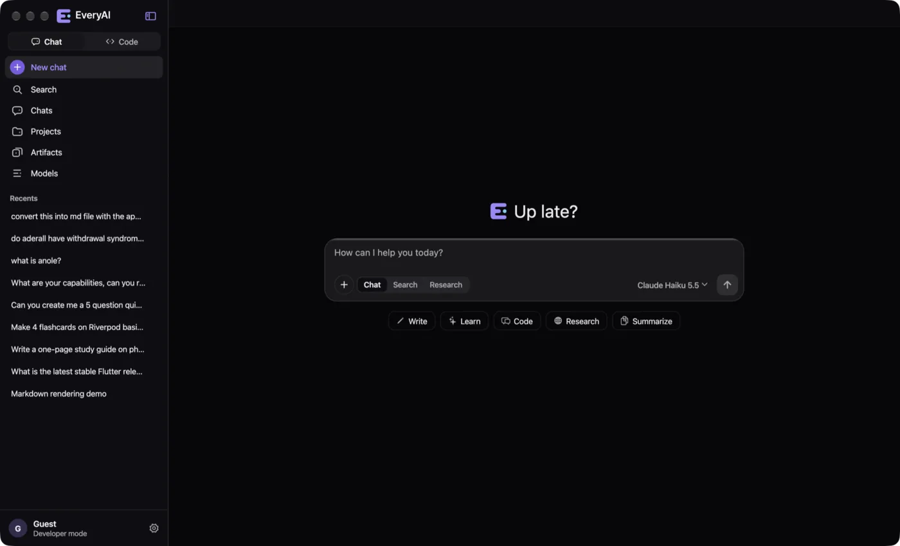

</div>


## ✦ Highlights

<table>
<tr>
<td width="33%" valign="top">

### 💬 Chat, Search, Research
Any of 380+ models in one composer. **Search** cites the web with source chips; **Research** runs deep multi-step reports; **follow-ups** suggest the next question. Retry with another model in one click.

</td>
<td width="33%" valign="top">

### 🧩 Rich answers
Models answer with **artifacts** (docs, code, HTML), **SVG** illustrations, **Mermaid** diagrams, **charts**, **quizzes**, **flashcards** and **slide decks**, all live in the app.

</td>
<td width="33%" valign="top">

### 🛠️ Code workspace
A bundled **OpenHands** agent in its own **git worktree** per session. Modes Ask · Auto-edit · Plan · Full auto. Question cards, plan approval, live diff, per-turn checkpoints with rewind.

</td>
</tr>
<tr>
<td valign="top">

### 📥 Download anything
One menu per artifact: **Markdown** (SVG inline), **Markdown + figures (.zip)**, **PDF**, **Word**, **PowerPoint**, **SVG/PNG**. Figures are drawn exactly as the app shows them.

</td>
<td valign="top">

### ✏️ Edits, not duplicates
`edit_artifact` revises a document in place with find-and-replace edits. The backend checks every edit and tells the model which ones missed.

</td>
<td valign="top">

### 💸 Honest billing
Free, Pro and Max plans plus prepaid top-ups at upstream cost × 1.15. Free models stay free. A live **token, cache and cost meter** sits in every composer.

</td>
</tr>
<tr>
<td valign="top">

### ⚡ Prompt caching
A constant system prompt and tool list with cache breakpoints for Claude and Gemini. A real agent turn went from **1,113 µ$ to 69 µ$** (94% saved).

</td>
<td valign="top">

### 📎 Attachments
Images, PDFs, audio and text files, greyed out per model when it can't read them. Drag and drop anywhere. Code sessions get them inside the worktree.

</td>
<td valign="top">

### 🎨 Native everywhere
Cupertino, Material, Fluent and macOS designs from one codebase, with glass surfaces and vibrancy, plus a brand mark that animates while the agent works.

</td>
</tr>
</table>


## ✦ Tour

<table>
<tr>
<td width="50%">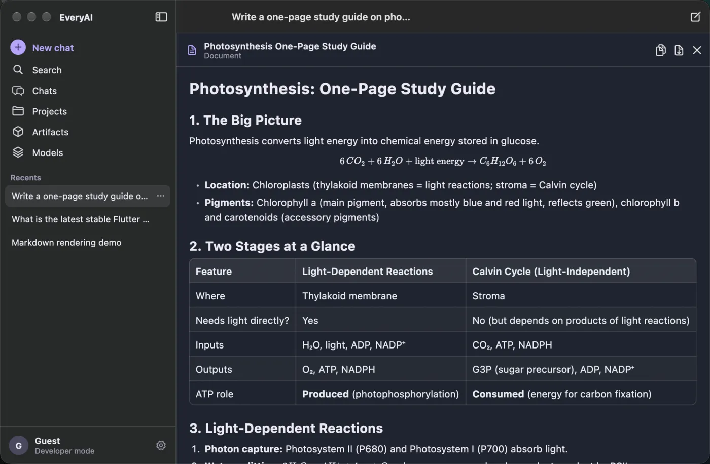<br/><sub><b>Artifacts</b> open beside the chat, with versions, copy and download.</sub></td>
<td width="50%">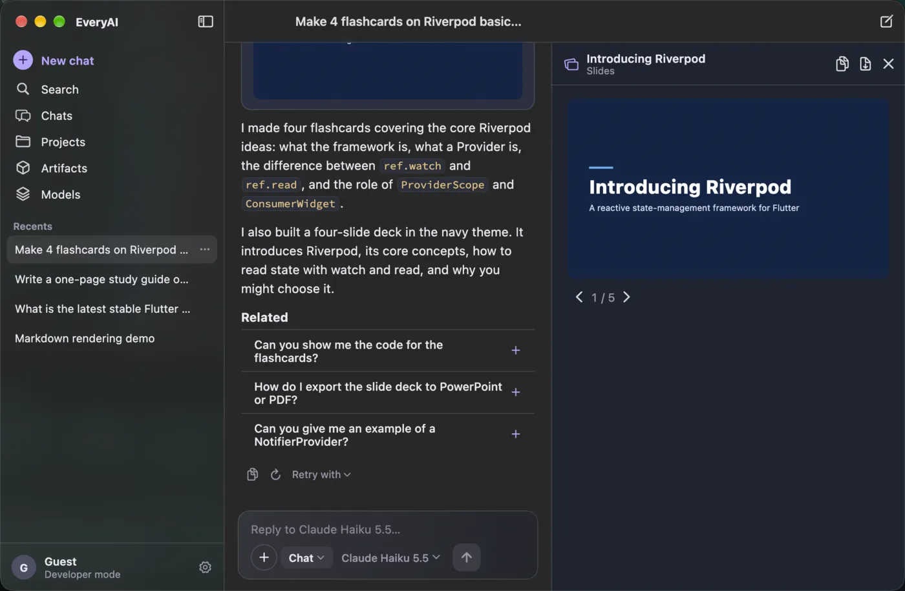<br/><sub><b>Slides</b> render in four themes and export to PowerPoint.</sub></td>
</tr>
<tr>
<td>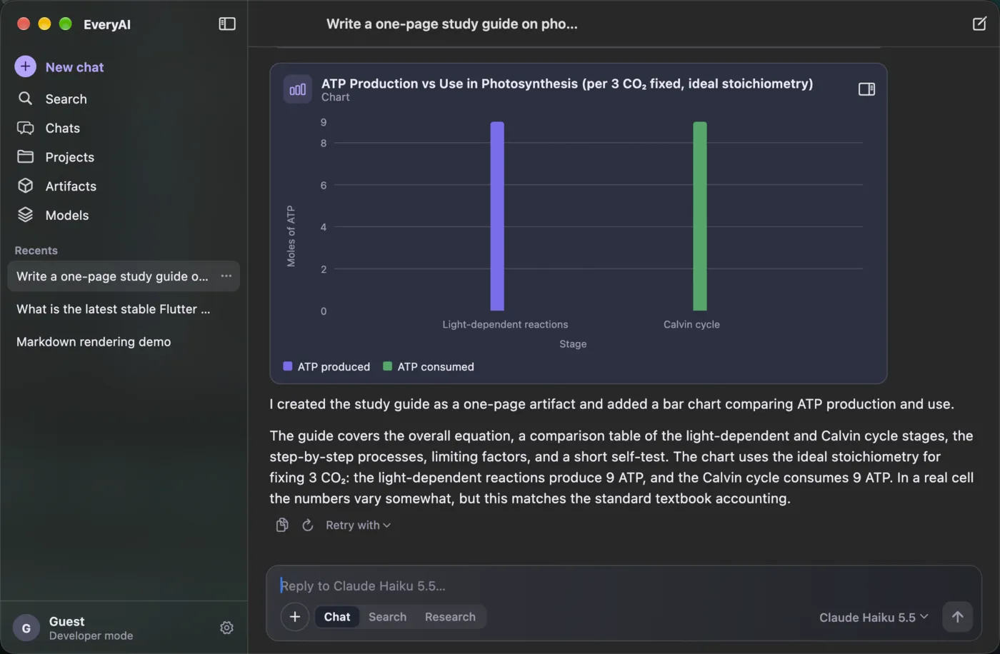<br/><sub><b>Charts</b>: line, area, bar, scatter and pie, drawn natively.</sub></td>
<td>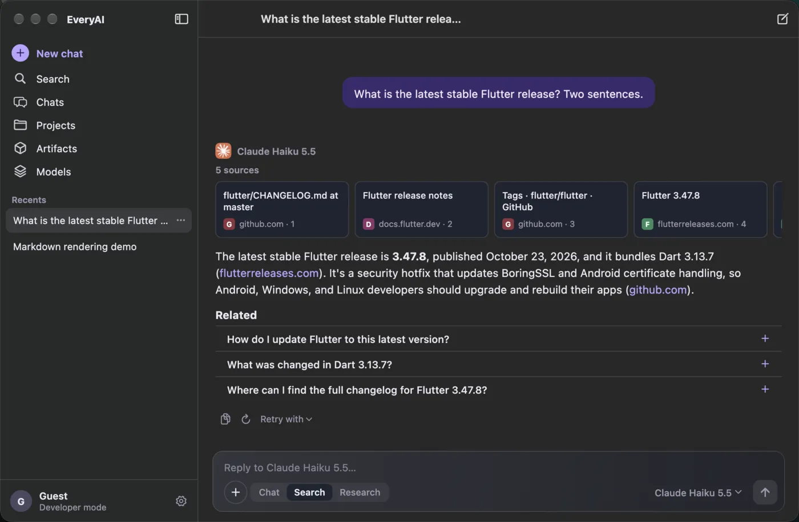<br/><sub><b>Search</b> with source chips and inline citations.</sub></td>
</tr>
<tr>
<td>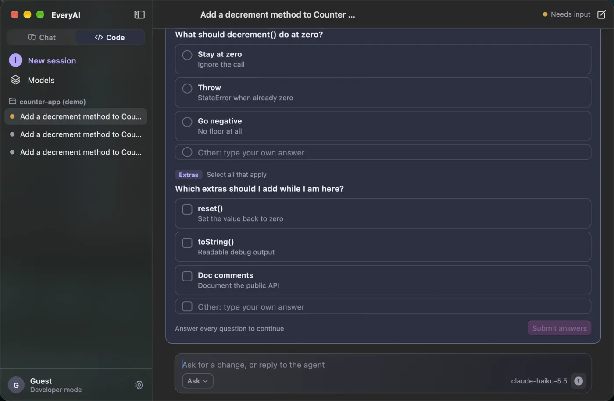<br/><sub><b>Question cards</b>: the agent asks, you pick, it builds.</sub></td>
<td>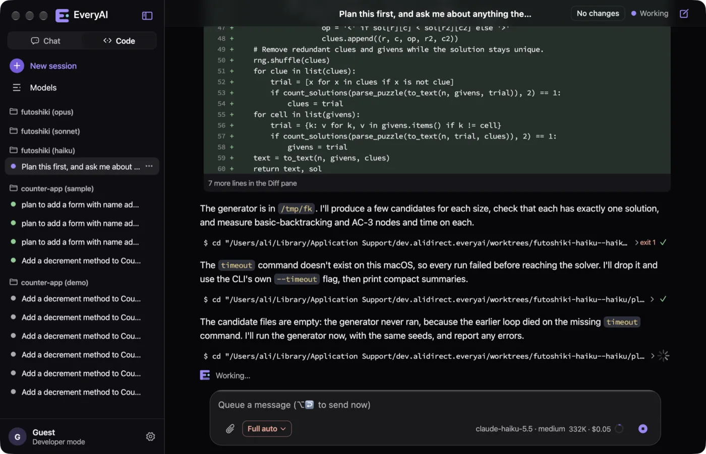<br/><sub><b>Code sessions</b> show steps, diffs, mode, model · effort and cost.</sub></td>
</tr>
<tr>
<td>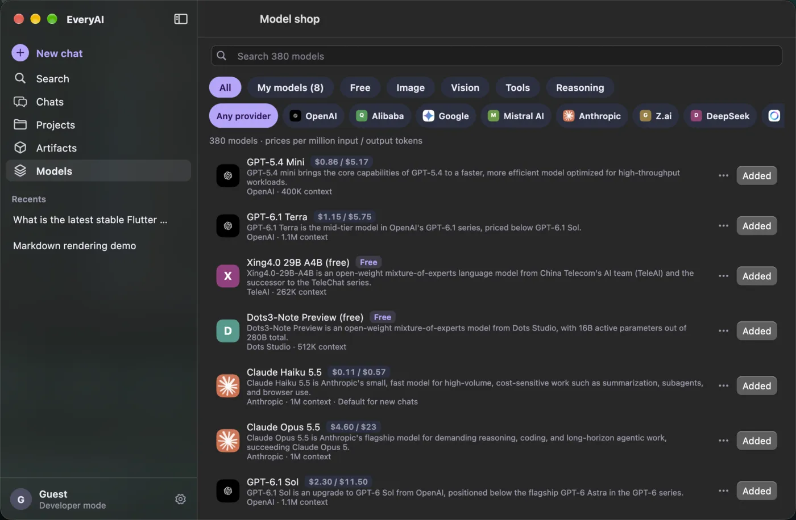<br/><sub><b>Model shop</b>: the whole OpenRouter catalog, with filters and vendors.</sub></td>
<td>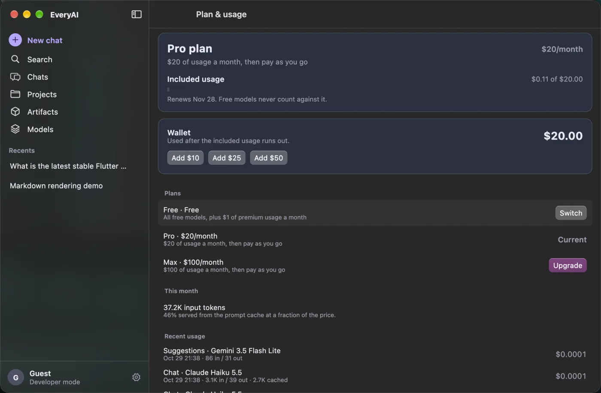<br/><sub><b>Plan & usage</b>: quota, wallet, cache savings and recent calls.</sub></td>
</tr>
</table>

<details>
<summary><b>One codebase, four design languages</b> (click to expand)</summary>
<br/>
<table>
<tr>
<td width="50%">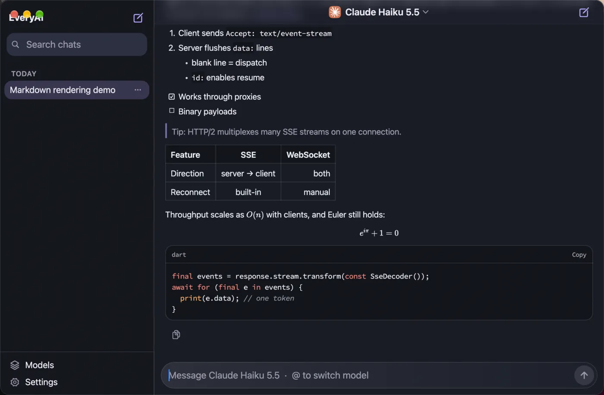<br/><sub>Cupertino</sub></td>
<td width="50%">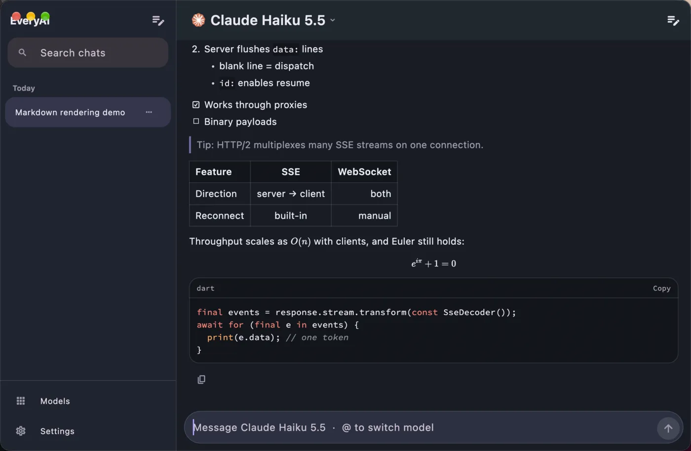<br/><sub>Material</sub></td>
</tr>
<tr>
<td>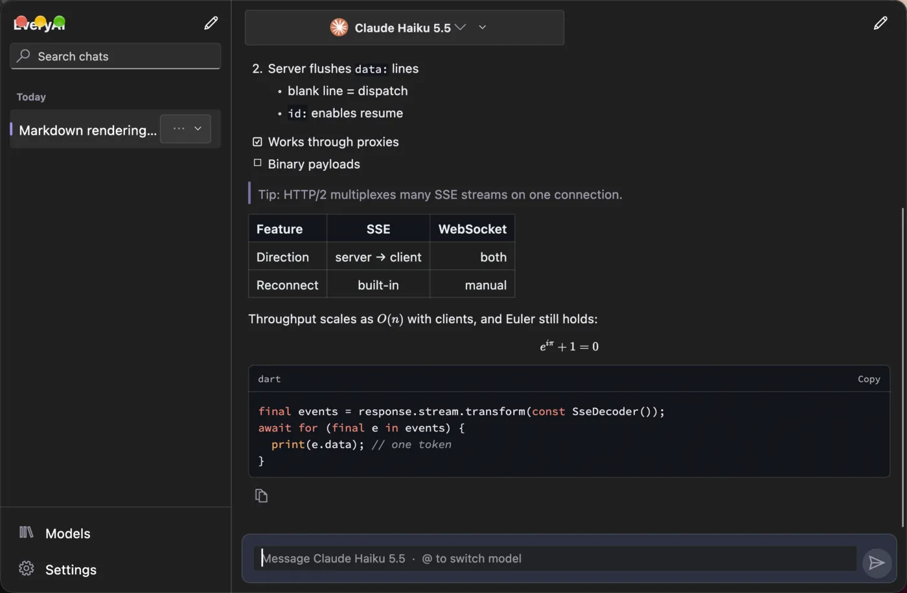<br/><sub>Fluent</sub></td>
<td>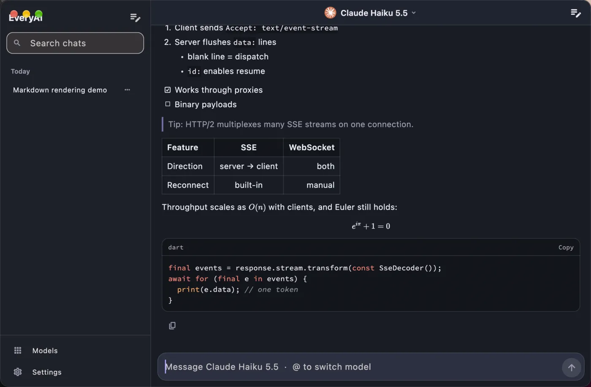<br/><sub>Adwaita-style</sub></td>
</tr>
</table>
</details>


## ✦ How it fits together

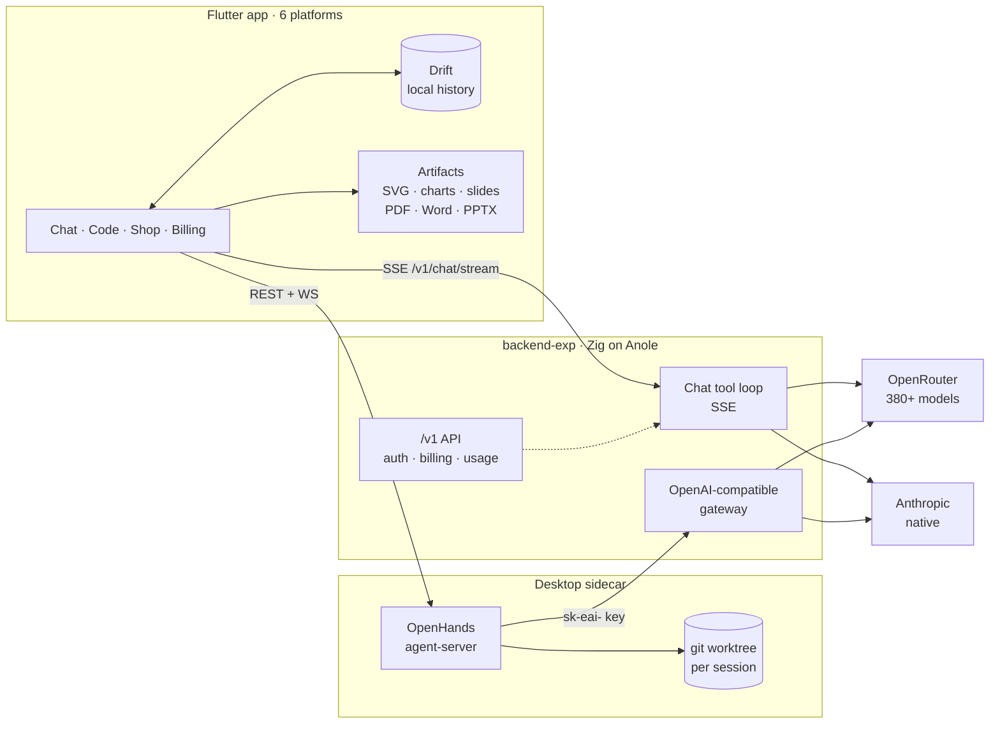


## ✦ Repository

| Path | What | Stack |
|---|---|---|
| [`frontend/`](frontend) | The app: chat, Code workspace, artifacts, model shop, billing |    |
| [`frontend/packages/everyai_markdown`](frontend/packages/everyai_markdown) | Streaming Markdown renderer: math, highlighting, citations |  |
| [`backend-exp/`](backend-exp) | The `/v1` API: auth, chat tool loop, gateway, images, billing |   |
| [`backend/`](backend) | Legacy FastAPI service, frozen and being replaced |  |
| [`docs/`](docs) | Research notes and design docs |  |
| [`scripts/`](scripts) | `dev.sh`, the one-command dev runner |  |

## ✦ Quick start

> [!NOTE]
> You need **Flutter 3.47**, **Zig 0.17** and the [Anole](https://github.com/xuckless/anole) checkout that `backend-exp/build.zig.zon` points at.

```sh
cp .env.example .env            # add OPENROUTER_API_KEY (and ANTHROPIC_API_KEY if you have one)
cp frontend/config/example.json frontend/config/dev.json

scripts/dev.sh macos            # or: web · ios-sim · ios · <device id>
```

`dev.sh` starts `backend-exp` on `:8080` (or reuses a running one), fetches the OpenHands agent-server for desktop, writes the right `API_BASE_URL` for the target, and runs the app.

<details>
<summary><b>Run the pieces by hand</b></summary>

```sh
# Backend (http://localhost:8080, API docs at /docs)
cd backend-exp && zig build run
zig build test

# App
cd frontend && flutter pub get
flutter run -d macos --dart-define-from-file=config/dev.json
flutter test
```

</details>

<details>
<summary><b>Configuration</b></summary>

- **Secrets:** one `.env` at the repo root (template `.env.example`). Never commit it.
- **`DEV_AUTH=true`:** anonymous requests act as a dev user on the Pro plan with $20 of credit.
- **Claude routing:** Settings → Developer chooses whether `anthropic/*` models go through OpenRouter or the native Anthropic API.
- **Firebase / Google Sign-In files** (`GoogleService-Info.plist`, `google-services.json`) are gitignored. Put them in the platform folders locally.

</details>

## ✦ Platforms

| | macOS | iOS | Android | Windows | Linux | Web |
|---|:-:|:-:|:-:|:-:|:-:|:-:|
| **Chat, artifacts, shop, billing** | ✅ | ✅ | ✅ | ✅ | ✅ | ✅ |
| **Code workspace** | ✅ | remote (planned) | remote (planned) | desktop build | desktop build | remote (planned) |
| **Inline web artifacts (HTML, Mermaid)** | ✅ | ✅ | ✅ | ✅ | open in browser | ✅ |
| **Verified so far** | ✅ daily driver | simulator | — | untested (needs CI) | untested (needs CI) | ✅ |

## ✦ Roadmap

<table>
<tr>
<td>🧠 <b>Agent robustness</b><br/><sub>truncation recovery · permission floor · compaction · subagents</sub></td>
<td>🖋️ <b>Vector art</b><br/><sub>design brief · resvg render check · "Polish" critique</sub></td>
<td>🔌 <b>Connectors</b><br/><sub>MCP client · OAuth vault · GitHub · Google · Notion</sub></td>
</tr>
<tr>
<td>🧭 <b>Ultra mode</b><br/><sub>an orchestrator running workflows over an agent library</sub></td>
<td>⌨️ <b>Slash commands</b><br/><sub>built-ins and Markdown custom commands</sub></td>
<td>🗂️ <b>Skills & memory</b><br/><sub>Agent Skills standard · capped memory · chat search</sub></td>
</tr>
</table>

The research behind it lives in [`docs/research/`](docs/research) (opencode, Hermes Agent, DeepSeek, MCP, Agent Skills, connectors, vector art and media).


<div align="center">


<sub>Copyright 2026 xuckless and Syed Ali. Source-available under the <a href="LICENCE.md">Functional Source License 1.1 (FSL-1.1-ALv2)</a>: use, modify and self-host it for any purpose except a competing product; each release becomes Apache-2.0 two years after it ships. See <a href="NOTICE">NOTICE</a>.<br/>"EveryAI" and its logo are trademarks of xuckless and Syed Ali and are not licensed.<br/>The bundled OpenHands agent-server is MIT-licensed; third-party notices ship with the app.</sub>

</div>
