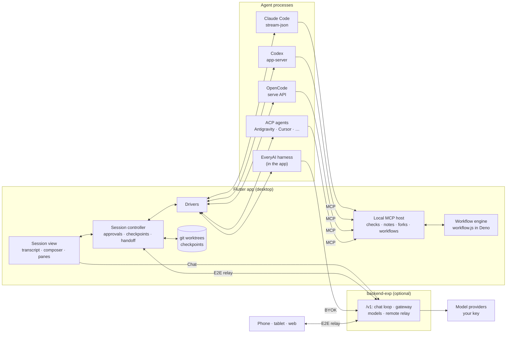

# Architecture

EveryAI is a Flutter app that does the work on the user's own computer, plus a small optional backend. Coding agents
run as local processes; the app talks to each one in its own protocol and gives all of them the same workspace.

## The pieces

- **Drivers** (`frontend/lib/features/code/drivers/`): one per protocol. Each turns its agent's events into the
  shared transcript (keeping the agent's own tool names, todos and plans), routes its approvals through the session,
  and reads its slash commands and modes. Outside agents run on the user's own install and sign-in.
- **The EveryAI harness** (`harness/everyai/`): our own agent loop in the app, for any model on the user's key: tools
  per model family, approvals with a hard safety floor, compaction, forks in worktrees, the shared browser and the
  `app` tool; local models are called directly, with a lighter profile for small ones.
- **The local MCP host** (`host/`): a loopback MCP server with a token per session. It serves every agent the same
  increments: `check`, `bug_check`, `diff_stats`, `goal_check`, `run_script`, memory and saved plans, Max's fork
  tools, and the workflows as MCP prompts. None of them spends EveryAI money.
- **Workflows** (`workflows/`, `assets/workflows/*.js`): Ultra, Bug fix and Security review run as JavaScript in the
  bundled Deno sandbox (`agent`, `parallel`, `pipeline`, `phase`, schema-checked results). Each `agent()` call can run
  on any listed agent, in its own worktree.
- **Handoff and resume** (`handoff/`, `resume/`): a session can move to another agent (native import into its session
  format where possible, otherwise facts plus the transcript file) and earlier sessions of any agent can be reopened.
- **Live views and the `app` tool** (`live/`): one Chrome per project shared by the agents and the Preview tab (take
  over / give back, a ghost cursor), and app sources for web and Electron, Flutter and React Native, the iOS
  Simulator (AXe), the Android emulator (adb, scrcpy) and desktop windows (a signed helper on macOS, a C# helper on
  Windows, a python3 helper and an Xvfb display per session on Linux). Screenshots carry frame ids; real input only
  reaches the app's own window.
- **Shells** (`shells/`): one registry for every command and background shell, kept as logs; background shells run
  in a pty, and every process (Docker and Podman containers too) opens in a terminal tab from Processes.
- **Local models** (`features/local_models/`, `core/local_backend/`): servers found on the computer, hardware-sized
  packs, and a copy of the backend bundled in the app that runs local and own-key chats on the computer.
- **Git** (`git/`): a worktree and branch per session, a checkpoint per turn, rewind for every agent.
- **Remote control** (`features/remote/`): phones, tablets and the web pair with the desktop and mirror its sessions
  over an end-to-end encrypted relay; the computer runs every session.
- **Chat** (`features/chat/`, `features/artifacts/`): the chat client, artifacts, exports and history (Drift, on the
  device).

## The backend

`backend-exp/` (Zig 0.17 on [Anole](https://github.com/xuckless/anole)) is optional for Code with outside agents. It
provides the chat tool loop (SSE), an OpenAI-compatible gateway the EveryAI harness uses, the model catalog, images,
and the remote-control relay. In the dev build it holds no provider keys: calls run on the key the user adds in the
app. The full `/v1` contract is in [`AGENTS.md`](../AGENTS.md#v1-contract-backend-exp--app); setup and endpoints are in
[`backend-exp/README.md`](../backend-exp/README.md).

## Repository

| Path | What |
|---|---|
| [`frontend/`](../frontend) | The app: Code workspace, drivers, MCP host, workflows, Chat, artifacts, remote control |
| [`frontend/packages/everyai_markdown`](../frontend/packages/everyai_markdown) | Streaming Markdown renderer: math, highlighting, citations |
| [`backend-exp/`](../backend-exp) | The optional `/v1` server (Zig on Anole) and its [deployment](../backend-exp/deploy/README.md) |
| [`docs/`](.) | Roadmaps, this file, [benchmarks](BENCHMARKS.md), research notes |
| [`scripts/`](../scripts) | `launch.sh` (app against the dev server) and `dev.sh` (local backend + app) |

## Platforms

| | macOS | Windows | Linux | iOS | Android | Web |
|---|:-:|:-:|:-:|:-:|:-:|:-:|
| **Code workspace and agents** | ✅ | build only, not yet tested | build only, not yet tested | remote control | remote control | remote control |
| **Chat and artifacts** | ✅ | ✅ | ✅ | ✅ | ✅ | ✅ |
| **Checked so far** | daily driver | CI build | CI build | simulator | — | ✅ hosted at [app.everyai.dev](https://app.everyai.dev) |

One EveryAI design on every platform since 2026-11-06: tokens in `EveryTheme`, the kit in `core/ui/kit.dart`, Geist
type and Lucide icons, with dark, light and Pure black themes. The four per-platform design languages (Cupertino,
Material, Fluent, Adwaita-style) were retired. Windows and Linux draw their own title bar.
